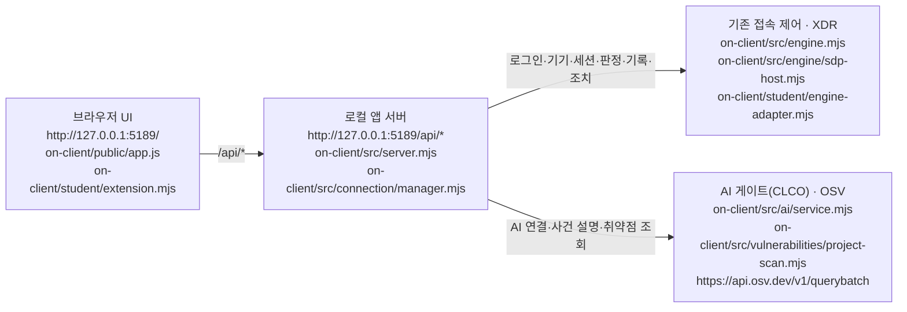

# 케셰브(Keshev) 보안 Agent (ALEPH 방어전 13~22단계)

로컬 웹 UI(`http://127.0.0.1:5189/`)에서 사용자 로그인·기기·세션 상태, 업무 앱 접속 판정, 보안 기록·AI 사건 설명, 보안 조치 상태, 설치 패키지 OSV 취약점 조회 결과를 확인하는 보안 Agent 프로젝트입니다.  
상세한 실행 설명서, 오류 코드별 복구 표, 확인·미확인(UNV) 목록은 [on-client/docs/STUDENT_RUNBOOK.md](on-client/docs/STUDENT_RUNBOOK.md) 에 정리되어 있습니다.

---

## 1. 지원 환경 및 확인한 버전

- **운영체제**: Windows (PowerShell)
- **시작 틀**: `alekov-client-starter` `0.2.21` (`on-client/package.json`)
- **Node.js**: 권장 `24.19.0` (`engines.node`) / 로컬 확인 `v24.21.0`
- **npm**: 로컬 확인 `12.2.0`
- **의존성 및 잠금 파일**: 외부 npm 패키지 없음 (`package-lock.json` 미포함)

---

## 2. 빠른 실행 및 종료 절차

1. 저장소 최상위 폴더에서 새 PowerShell 창을 열고 앱 폴더(`on-client`)로 이동합니다.
   ```powershell
   cd on-client
   ```
2. 학생 코드 구문을 점검합니다.
   ```powershell
   npm run check
   ```
3. 서버를 실행합니다.
   - **기본 실행** (`disconnected` 상태, 실제 어댑터 연결 전):
     ```powershell
     npm start
     ```
     정상 시작 신호(직접 확인): `케셰브 연결 확인: http://127.0.0.1:5189`
   - **예제(데모) 실행** (모의 데이터 화면 점검용):
     ```powershell
     npm run demo
     ```
     정상 시작 신호(직접 확인): `케셰브 예제: http://127.0.0.1:5189`
4. 브라우저에서 `http://127.0.0.1:5189/` 를 엽니다.
5. **종료 및 재실행**: 실행한 PowerShell 창에서 `Ctrl+C` 로 종료한 뒤, 같은 폴더에서 위 명령을 다시 실행합니다.

> `tools/start-alekov.ps1` 실행 안내는 `on-client/docs/STUDENT_LAUNCH_GUIDE.md` 를 참고하세요(직접 실행은 미확인).  
> API 키·토큰·비밀번호 등 민감 정보는 커밋되는 파일과 문서에 넣지 않으며, 비밀 없는 설정 예시만 `on-client/.env.example` 에 있습니다.

---

## 3. 시스템 구성도



- **브라우저 UI** (`on-client/public/index.html`, `on-client/public/app.js`, `on-client/student/extension.mjs`): 서버 응답을 검증한 뒤 학생 뷰에 전달하며 `createElement`·`textContent`로만 화면을 그립니다.
- **로컬 앱 서버** (`on-client/src/server.mjs`): `127.0.0.1:5189` 로만 수신하고 인증·요청 크기·호스트·오리진 검증을 수행합니다.
- **기존 접속 제어 · XDR 시스템** (`on-client/src/engine.mjs`, `on-client/src/engine/sdp-host.mjs`, `on-client/src/actions/sdp-action-engine.mjs`, `on-client/student/engine-adapter.mjs`): 어댑터 미연결 시 `ENGINE_NOT_CONNECTED` 를 반환합니다.
- **AI 게이트(CLCO) · OSV 조회** (`on-client/src/ai/service.mjs`, `on-client/src/vulnerabilities/osv.mjs`): 서버 측 자격 보관함을 거쳐 AI 점검/설명을 중계하고, 승인된 공개 패키지만 `https://api.osv.dev/v1/querybatch` 로 조회합니다.

---

## 4. 제공 코드와 학생 작성 구분

- **제공 원본 유지 (`on-client/.on-starter-manifest.json` 75개 중 74개)**: `on-client/src/*`, `on-client/public/*`, `on-client/tools/*`, `on-client/README.md`, 기존 `on-client/docs/*` 는 수정하지 않았습니다.
- **학생 구현 코드 (`on-client/student/extension.mjs`)**:
  - `renderIdentity` (13단계), `renderDecision` (14단계), `renderEvents` (15·16단계), `renderStatus` (16단계), `renderAiConnection` (17단계), `renderExplanation` (17·18단계), `renderAction` (19단계), `renderVulnerabilities` (20단계)
- **학생 작성 문서**: `README.md`, `on-client/docs/STUDENT_RUNBOOK.md`

---

## 5. 장애 안내 및 확인·미확인 범위 요약

- **`ENGINE_NOT_CONNECTED` / `ON_AI_PROVISIONING_PENDING` / `PROJECT_NOT_CONFIGURED`**: 각각 어댑터 미연결, 운영 측 AI 권한 준비 중, 조회 대상 프로젝트 미설정 상태이며 정상·취약점 없음·실행 성공으로 표시하지 않습니다. 오류 코드별 복구 표는 [on-client/docs/STUDENT_RUNBOOK.md](on-client/docs/STUDENT_RUNBOOK.md) 7장을 참고하세요.
- **확인 완료**: `npm run check`, `npm start`/`npm run demo` 기동 및 `/api/diagnostics` 응답, 데모 모드 브라우저 렌더링(13~20단계), 모의 데이터 단위 테스트.
- **미확인 / 기다림(UNV)**: 운영 SDP `connected` 실제 연동, 알레프게이트/CLCO OAuth 승인 후 `verified` 모델 점검 및 실제 사건 설명 `ok` 응답, 지원 조치 집행·관측, 승인 패키지 및 `package-lock.json` 기반 OSV 실조회, `tools/start-alekov.ps1`·`npm run package-app` 직접 실행.
