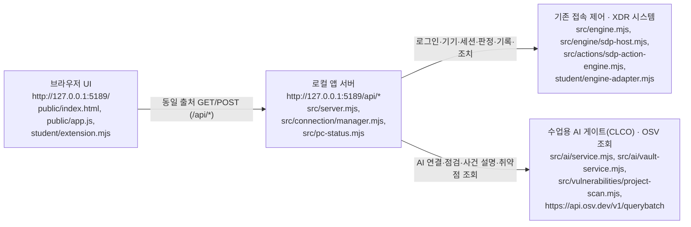

# 케셰브(Keshev) 학생 실행 설명서 및 시스템 구성도 (21단계)

이 문서는 보안 Agent **케셰브** 프로젝트의 실행 방법, 시스템 구성, 제공 코드와 학생 구현의 경계, 오류별 확인 절차, 그리고 실제 확인/미확인 범위를 정리한 학생 작성 문서입니다. 시작 틀에 포함된 기존 공식 문서(`on-client/README.md`, `on-client/docs/*`)는 수정하지 않고 보존했습니다.

---

## 1. 목적 및 주요 기능

- **목적**: 회사(또는 학습 환경) 사용자가 로컬 보안 Agent 웹 UI(`http://127.0.0.1:5189/`)를 통해 로그인·기기·세션 상태, 업무 앱 접속 판정, 접속·XDR 보안 기록, AI 연결/사건 설명, 보안 조치 상태, 설치 패키지 OSV 취약점 조회 결과를 한눈에 확인하되, **추측이나 자동 실행 없이 원천 상태와 근거를 정확히 구분해 표시**하는 앱입니다.
- **학생 구현 범위**: `on-client/student/extension.mjs` 내 8개 렌더링 함수 (`renderIdentity`, `renderDecision`, `renderEvents`, `renderStatus`, `renderAiConnection`, `renderExplanation`, `renderAction`, `renderVulnerabilities`) 구현 완료.

---

## 2. 지원 환경 및 확인한 버전

| 항목 | 기준 / 확인 내용 | 비고 |
|---|---|---|
| 운영체제 | Windows (PowerShell) | 로컬 확인 완료 |
| 시작 틀 버전 | `alekov-client-starter` `0.2.21` | `on-client/package.json` |
| Node.js | `engines.node`: `24.19.0` / 로컬 실측: `v24.21.0` | ESM (`"type": "module"`) |
| npm | 로컬 실측: `12.2.0` | 외부 npm 의존성 없음 |
| 잠금 파일 | `package-lock.json` 없음 | 외부 의존성 0개 상태 |

---

## 3. 폴더 구조 및 작업 위치

- **Git 저장소 최상위(루트)**: `<프로젝트 폴더>` (저장소를 받은 최상위 폴더, 커밋 및 제출 기준 위치)
- **앱 실행 작업 폴더**: `<프로젝트 폴더>/on-client`

```text
aleph_defense/                  # Git 루트
├── README.md                   # 학생 작성 루트 개요 문서
└── on-client/                  # 앱 실행 및 개발 폴더
    ├── package.json            # 실행 스크립트 (start, demo, check, package-app)
    ├── .env.example            # 비밀값 없는 환경 설정 예시
    ├── .on-starter-manifest.json # 스타터 원본 SHA-256 목록 (75개 파일)
    ├── README.md               # 제공 문서 (원본 보존)
    ├── docs/
    │   ├── STUDENT_RUNBOOK.md  # 학생 작성 실행 설명서 (이 문서)
    │   └── ...                 # 제공 문서들 (원본 보존)
    ├── public/                 # 제공 브라우저 UI (index.html, app.js, *-view.mjs)
    ├── src/                    # 제공 로컬 서버, 연결 관리자, AI/OSV/조치 서비스
    ├── student/
    │   ├── extension.mjs       # 학생 구현 UI 모듈 (13~20단계 구현)
    │   └── engine-adapter.mjs  # 제공 엔진 어댑터 틀 (원본 보존)
    └── tools/                  # 실행·패키징·네이티브 호스트 보조 스크립트
```

---

## 4. 설치 · 실행 · 종료 · 재실행 절차

### 4.1 사전 확인
1. 저장소 최상위 폴더에서 새 PowerShell 창을 열고 앱 폴더(`on-client`)로 이동합니다.
   ```powershell
   cd on-client
   ```
2. Node.js 버전 및 학생 코드 문법을 확인합니다. (외부 npm 패키지가 없으므로 `npm install`은 필요하지 않습니다.)
   ```powershell
   node -v
   npm run check
   ```
   - 확인된 정상 출력: `node --check student/extension.mjs` 오류 없이 종료 코드 `0`.

### 4.2 서버 실행 (기본 모드 vs 예제 모드)

- **기본 실행 (연결 확인 모드, 실제 어댑터 미연결 시 `disconnected`)**:
  ```powershell
  npm start
  ```
  (내부 실행: `node src/server.mjs`)
  - **정상 시작 신호** (직접 실행 확인): 콘솔에 `케셰브 연결 확인: http://127.0.0.1:5189` 출력, `GET /api/diagnostics` 응답에서 `engine.mode: "disconnected"`, `engine.code: "ENGINE_NOT_CONNECTED"`.

- **예제(데모) 실행 (모의 데이터 화면 확인용, 성취/실연결 아님)**:
  ```powershell
  npm run demo
  ```
  (내부 실행: `node src/server.mjs --demo`)
  - **정상 시작 신호** (직접 실행 확인): 콘솔에 `케셰브 예제: http://127.0.0.1:5189` 출력, `GET /api/diagnostics` 응답에서 `engine.mode: "demo"`, `engine.code: "DEMO_ONLY"`.

- **PowerShell 런처 스크립트** (`on-client/docs/STUDENT_LAUNCH_GUIDE.md` 안내, **미확인**: 본 세션에서 직접 실행하지 않음):
  ```powershell
  powershell -NoProfile -ExecutionPolicy Bypass -File .\tools\start-alekov.ps1
  ```

### 4.3 브라우저 확인
- 브라우저에서 `http://127.0.0.1:5189/` 를 엽니다.
- 상단 상태 영역, **보호 현황** / **업무 앱** / **보안 기록** 탭, 그리고 각 학생 구현 슬롯(`student/extension.mjs`)이 오류 없이 표시되는지 확인합니다.

### 4.4 종료 및 재실행
- **종료**: 서버를 실행한 PowerShell 창에서 `Ctrl+C` 를 눌러 프로세스를 종료합니다.
- **재실행**: 같은 `on-client` 폴더에서 `npm start` 또는 `npm run demo` 를 다시 실행한 뒤 브라우저를 새로고침합니다.
- 실행·종료·재실행 과정에서 `student/extension.mjs`나 Git 이력은 변경되지 않습니다.

### 4.5 런타임 설정 참고 (`on-client/.env.example`)
- `ON_PORT=5189`, `ON_ENGINE_ADAPTER=./student/engine-adapter.mjs`, `ON_AI_MODEL=aleph/auto`, `ON_PROJECT_DIRECTORY=`, `ON_APPROVED_PUBLIC_PACKAGES=[]`
- API 키·토큰·비밀번호 등 민감 정보는 커밋 대상 파일이나 문서에 적지 않으며, 로컬 전용 환경에만 보관합니다.

---

## 5. 시스템 구성도



### 상자별 역할 및 실제 파일·주소 대응표 (글 설명)

| 구성 요소 | 실제 파일 경로 / 공개 주소 | 주요 역할 |
|---|---|---|
| **1. 브라우저 UI** | `on-client/public/index.html`, `on-client/public/app.js`, `on-client/public/vulnerabilities-view.mjs`, `on-client/public/ai-connect.mjs`, `on-client/student/extension.mjs` (`http://127.0.0.1:5189/`) | 제공 UI가 `/api/*`를 조회·검증하고, `studentData(kind)`로 정제된 스냅샷을 `student/extension.mjs`에 전달합니다. 브라우저에는 AI 키나 인증 비밀이 저장되지 않습니다. |
| **2. 로컬 앱 서버** | `on-client/src/server.mjs`, `on-client/src/connection/manager.mjs`, `on-client/src/pc-status.mjs`, `on-client/src/actions/service.mjs` (`http://127.0.0.1:5189/api/*`) | Loopback(`127.0.0.1:5189`)으로만 바인딩해 정적 파일과 `/api/me`, `/api/apps`, `/api/access`, `/api/events`, `/api/devices`, `/api/sessions`, `/api/diagnostics`, `/api/ai/*`, `/api/actions/*`, `/api/vulnerabilities`를 제공합니다. |
| **3. 기존 접속 제어 · XDR 시스템** | `on-client/src/engine.mjs`, `on-client/src/engine/sdp-host.mjs`, `on-client/src/engine/sdp-host-config.mjs`, `on-client/src/actions/sdp-action-engine.mjs`, `on-client/student/engine-adapter.mjs` | 사용자·기기·세션·업무 앱 접근 판정(`allow`/`deny`/`challenge`/`unknown`)과 보안 기록·지원 조치 집행 결과(`observation`)를 제공합니다. 기본 실행 시 어댑터가 연결되지 않으면 `ENGINE_NOT_CONNECTED`를 반환합니다. |
| **4. 수업용 AI 게이트웨이(CLCO) · OSV** | `on-client/src/ai/service.mjs`, `on-client/src/ai/vault-service.mjs`, `on-client/src/ai/app-authorization.mjs`, `on-client/src/vulnerabilities/project-scan.mjs`, `on-client/src/vulnerabilities/osv.mjs` (`https://api.osv.dev/v1/querybatch`) | 서버 측 보관 자격으로 AI 연결(`connect/*`)·모델 점검(`/api/ai/check`)·사건 설명(`/api/ai/explain`)을 중계하고, 승인된 공개 패키지의 `package-lock.json` 버전을 OSV API와 대조합니다. |

---

## 6. 제공 코드와 학생 작성 코드의 구분 (Manifest 기준)

`on-client/.on-starter-manifest.json` 에 등록된 75개 시작 틀 원본 파일 중 **학생 수정 파일은 `on-client/student/extension.mjs` 하나뿐**이며, 나머지 74개 파일(`src/*`, `public/*`, `tools/*`, 기존 `docs/*`, `on-client/README.md` 등)은 수정하지 않고 유지했습니다.

| 영역 | 파일 | 담당 기능 / 구현 내역 |
|---|---|---|
| **제공 영역 (수정 금지)** | `on-client/src/*`, `on-client/public/*`, `on-client/tools/*`, `on-client/docs/*` 기존 문서, `on-client/README.md` | HTTP 서버, 인증/세션 관리, 입력/출력 계약 검증, 타임아웃/취소 처리, AI·OSV·조치 서버 연동, 제공 UI 카드 및 버튼 제어 |
| **학생 구현** | `on-client/student/extension.mjs` (`createStudentView`) | 아래 8개 함수 전부 `document.createElement` + `textContent` 로만 DOM 구성 (`innerHTML` 미사용, 직접 API 호출/비밀 출력 없음) |
| **학생 문서** | `README.md`, `on-client/docs/STUDENT_RUNBOOK.md` | 실행 설명서, 구성도, 장애 안내, 확인·미확인 범위 정리 |

### `on-client/student/extension.mjs` 구현 함수 요약

| 단계 | 함수명 | 화면 슬롯 (`index.html`) | 표시 내용 및 안전 규칙 |
|---|---|---|---|
| 13 | `renderIdentity` | `#student-identity` | 로그인 사용자(`me`), 등록 기기 목록(`devices`), 세션(`sessions`)과 `connected`/`demo`/`disconnected`/`unknown` 모드, `loading`/`error`/`unknown` 구분 표시 |
| 14 | `renderDecision` | `#student-decision` | 업무 앱 접속 판정(`allow`/`deny`/`challenge`/`unknown`), 판정 이유·시각, `idle`/`loading`/`error` 구분(`allow` 오표기 방지) |
| 15·16 | `renderEvents` | `#student-events` | 접속 기록(`access`)·XDR 경보(`xdr`) 필터링, 사건 선택 상세(`data-student-event-detail`), 근거/규칙 목록, `supportedActions` 존재 시 `<action> 미지원` 비활성 버튼(요청 미전송) |
| 16 | `renderStatus` | `#student-status` | 기기·세션(단일 검증 세션 범위 명시)·주의 알림(`notifications`)·비밀 제외 도움정보(`requestId`, `component`, `version`, `checkedAt`, `engine.mode`, `engine.code`) 및 `도움정보 복사` 버튼, 오류 시 수동 재시도 안내 |
| 17 | `renderAiConnection` | `#student-ai-connection` | `idle`/`loading`/`ok`(`test` vs `verified`, `modelCount`, `checkedAt`, 사건 설명 미실행 명시)/`error`(권한 준비·인증·한도·시간 초과·취소·모델 없음 분류, 시크릿 마스킹, 수동 재점검 안내) |
| 17·18 | `renderExplanation` | `#student-explanation` | 검증된 `ok` 설명에만 `data-student-explanation-event={event.id}` 부착, 근거 ID 대조, `unknown` 상태 나열, `executed: true`/근거 불일치/부족 거절, 제안 미실행 명시(실행 버튼 없음) |
| 19 | `renderAction` | `#student-action` | 11종 조치 상태(`idle`~`error`) 구분, ACK(`pending`)≠효과, `succeeded`는 `effectApplied === true`일 때만 효과 확인(아니면 `unknown`), `data-student-action-event`/`request` 부착(불일치 거절), 확인 티켓 비노출 |
| 20 | `renderVulnerabilities` | `#student-vulnerabilities` | `idle`/`loading`/`error` 분리, `data.status` 5종(`complete`, `partial`, `not_checked`, `not_configured`, `unverifiable`) 구분, 행마다 `data-student-package-name`/`version`, `id`·`modified`, `unverifiable` 부분 ID 유지, 실패≠취약점 없음 |

---

## 7. 장애 · 실패 문구별 원인 및 확인 절차

| 화면 문구 / 오류 코드 | 원인 | 확인할 위치 | 복구 및 대응 방법 |
|---|---|---|---|
| `ENGINE_NOT_CONNECTED` / `연결 없음 (disconnected)` | 기본 실행 시 기존 서버 어댑터가 연결되지 않음 | 상단 연결 배지, `#student-status`, `#student-identity` | 운영 환경 연결이 필요하면 담당자의 어댑터 설정 안내를 확인하고, 로컬 UI 확인 목적이면 `npm run demo`로 예제 데이터를 확인합니다. |
| `NETWORK_ERROR` / `로컬 서버에 연결할 수 없습니다.` | 로컬 Node 서버가 중지됐거나 포트가 다름 | `#student-identity`, `#student-status` | 서버 실행 창에서 프로세스 동작 여부를 확인한 뒤 `npm start` 또는 `npm run demo`로 다시 켜고 상단 **다시 불러오기** 버튼을 직접 누릅니다. |
| `TIMEOUT` / `REQUEST_TIMEOUT` / `WB_CLCO_TIMEOUT` / `ACTION_TIMEOUT` | 서버·AI·조치 응답 시간 초과 | `#student-status`, `#student-ai-connection`, `#student-explanation`, `#student-action` | 자동 재시도하지 않으므로 잠시 뒤 사용자가 해당 카드의 버튼(**다시 불러오기**, **AI 연결 점검**, **원천 결과만 재조회**)을 직접 누릅니다. 특히 조치 `unknown`은 효과 없음으로 단정하지 말고 결과만 재조회합니다. |
| `CANCELLED` / `WB_CLCO_CANCELLED` / `점검 취소됨` | 사용자가 취소 버튼을 눌렀거나 새 요청이 이전 요청을 대체함 | `#student-ai-connection`, `#student-vulnerabilities` | 이전 모델 수·취약점 표는 현재 결과가 아니므로 참고하지 않고, 필요할 때 점검/조회 버튼을 직접 다시 누릅니다. |
| `ON_AI_PROVISIONING_PENDING` | 운영 측 학생 계정·앱 권한 발급/연결 준비 중 | `#student-ai-connection`, `#student-explanation` | 학생 코드 오류가 아닙니다. 담당자에게 계정 연결 및 앱 권한 준비 상태를 확인 요청합니다. |
| `WB_CLCO_AUTH_REQUIRED` / `WB_CLCO_ACCESS_BLOCKED` / `SUBJECT_SCOPE_UNVERIFIED` | 계정 승인 만료·인증 실패·이용 제한 | `#student-ai-connection` | Workbench 열쇠나 토큰을 코드/설정에 복사하지 말고, 제공 UI의 계정 연결·AI 연결 절차를 다시 확인하거나 담당자에게 문의합니다. |
| `WB_CLCO_COHORT_BUDGET_EXHAUSTED` / `WB_CLCO_LIMIT_REACHED` / `WB_CLCO_SESSION_CLOSED` / `ON_AI_MODEL_LIST_EMPTY` | 반 사용량 소진, 한도 도달, 이용 시간 외, 허용 모델 없음 | `#student-ai-connection` | 이용 시간 확인 또는 담당자에게 반 한도/모델 허용 설정을 문의합니다. |
| `ON_AI_INVALID_OUTPUT` / `근거가 맞지 않음` | AI 응답 형식이 잘못됐거나 인용 근거 ID가 사건 근거에 없음 | `#student-explanation` | 잘못된 설명은 표시하지 않고 기존 보안 기록을 그대로 유지합니다. 필요 시 다른 기록을 확인하거나 재요청합니다. |
| `PROJECT_NOT_CONFIGURED` / `NO_APPROVED_PACKAGES` / `LOCKFILE_UNVERIFIABLE` | 조회 대상 프로젝트/승인 패키지 미설정 또는 `package-lock.json` 확인 불가 | `#student-vulnerabilities` | 미조회·확인 불가 상태이므로 "취약점 없음"으로 해석하지 않습니다. `ON_PROJECT_DIRECTORY` / `ON_APPROVED_PUBLIC_PACKAGES` 설정은 운영자 안내를 따릅니다. |
| 포트 충돌 (`EADDRINUSE` 등) | `5189` 포트를 다른 프로세스가 사용 중 | PowerShell 서버 실행 창 | 기존 프로그램을 강제 종료하지 말고 `$env:ON_PORT='5190'; npm start` 처럼 `ON_PORT` 환경 변수를 지정하거나, 실행 도구(`powershell -NoProfile -ExecutionPolicy Bypass -File .\tools\start-alekov.ps1 -Port 5190`)의 `-Port` 인자를 사용해 `http://127.0.0.1:5190/` 으로 실행합니다. (`src/server.mjs`는 `ON_PORT` 환경 변수만 읽습니다.) |

---

## 8. 지원 범위 · 직접 확인한 항목과 미확인(기다림/UNV) 항목

### 8.1 직접 확인한 항목 (로컬 검증 완료)
- `node --check on-client/student/extension.mjs` (`npm run check`) 구문 검사 통과
- `.on-starter-manifest.json` 대조 검사: 시작 틀 원본 중 `student/extension.mjs`만 수정됨 확인
- `npm start` (`node src/server.mjs`) 및 `npm run demo` (`node src/server.mjs --demo`) 실행 시 콘솔 시작 문구와 `GET /api/diagnostics` JSON 응답(`disconnected` / `demo`) 직접 확인
- 로컬 데모 서버(`--demo`) + 브라우저 UI 실확인:
  - 13~16단계: `#student-identity`, `#student-decision`, `#student-events`(상세 패널 포함), `#student-status`(기기·단일 세션 안내·알림·`도움정보 불러오기` 후 6개 안전 필드 및 `도움정보 복사`, 서버 종료 후 오류 전환) 동작 확인
  - 17~18단계: `#student-ai-connection` 초기 `idle` 및 `ON_AI_PROVISIONING_PENDING` 오류 안내, `#student-explanation` 초기 `event === null` 안내·오류 시 `data-student-explanation-event` 미부착 및 비AI 기능(`#tab-apps` 접속 판정) 정상 유지 확인
  - 19단계: `#student-action` 초기 `idle` 및 지원 조치 없음 정상 안내·버튼 0개 확인
  - 20단계: `#student-vulnerabilities` 초기 `idle` 및 `설치 패키지 조회` 클릭 후 `not_configured` (`PROJECT_NOT_CONFIGURED`) 표시 확인
- 단위 테스트 (모의 입력 기반, scratch 테스트 스크립트로 검증):
  - `renderStatus` 로딩/빈 목록/오류/알림/도움정보 마스킹·복사, `renderAiConnection` 전 상태 및 12종 오류 코드 분류·시크릿 마스킹, `renderExplanation` 근거 ID 대조·`unknown` 나열·`executed: true` 및 불일치 거절, `renderAction` 11종 상태·`effectApplied` 검증·영수증 불일치 거절·티켓 비노출, `renderVulnerabilities` `data.status` 5종·패키지 행 속성·`unverifiable` 부분 ID 유지 검증 완료

### 8.2 미확인 / 기다림 (UNV) 항목
- **실제 회사/운영 SDP 서버 `connected` 모드 연동**: 운영 어댑터 및 호스트 연결 전이므로 `connected` 상태의 실제 로그인·기기·세션·접속 판정·보안 기록 응답은 미확인입니다.
- **실제 알레프게이트 OAuth 승인 및 `verified` AI 응답**: 운영 권한(`ON_AI_PROVISIONING_PENDING`) 발급 전이므로 실제 `verified` 모델 점검, 실제 AI 사건 설명 `ok` 응답, 두 실제 이벤트 간 전환은 로컬 모의 단위 테스트로만 확인했고 실제 게이트 연동은 **기다림(UNV)** 입니다.
- **실제 보안 조치 집행 및 관측 (`prepared` → `executing` → `pending` → `succeeded`)**: 현재 기록의 `supportedActions`가 비어 있어 실제 원천 집행·관측은 미확인(**기다림/UNV**) 입니다.
- **실제 프로젝트 OSV 취약점 조회 (`complete` / `partial`)**: 저장소에 `package-lock.json` 및 승인 패키지 설정이 없어 `PROJECT_NOT_CONFIGURED` 까지만 브라우저에서 확인했고, 실제 패키지 행 목록 및 `lockfileHash` 갱신은 단위 테스트로만 검증했습니다(**기다림/UNV**).
- **`tools/start-alekov.ps1` 및 `npm run package-app`**: 본 작업에서는 `node src/server.mjs` / `npm run demo` 로 검증했으며, `.ps1` 런처와 패키징 스크립트 직접 실행은 미확인입니다.
